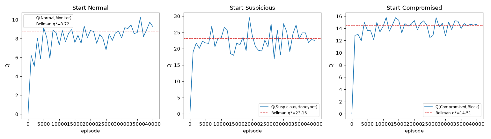
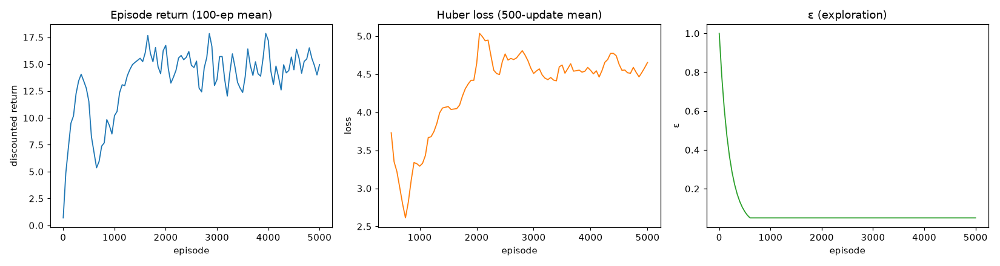
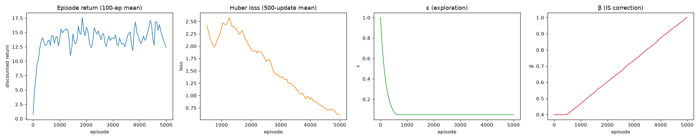

# 🛡️ RL-Based Intrusion Detection — DQN Agent

<p align="center">
  
  
  
  
  
</p>

> An autonomous network intrusion-detection and response agent trained with
> value-based reinforcement learning — a **tabular Monte-Carlo control**
> sanity check first, then **Double DQN + Prioritized Experience Replay** —
> inside a custom **Gymnasium** environment. Telemetry comes from
> **CSE-CIC-IDS2018** and **CIC-IDS2017**; the attack ground-truth label is used
> **only for the reward and for evaluation**, never as an observation.

---

## 📑 Table of Contents

- [Overview](#-overview)
- [MDP Formulation](#-mdp-formulation)
- [State Space](#-state-space-s)
- [Action Space](#-action-space-a)
- [Reward Function](#-reward-function-r)
- [Environment](#-custom-gymnasium-environment)
- [Datasets](#-datasets)
- [Project Structure](#-project-structure)
- [Installation](#-installation)
- [Usage](#-usage)
- [Phase Status & Docs](#-phase-status--docs)
- [Results So Far](#-results-so-far)
- [Roadmap](#-roadmap)
- [Course Objectives](#-course-objectives)

---

## 🔍 Overview

Signature-based IDS rely on static rules that fail against novel or adaptive
threats. This project replaces the rule set with a **self-learning agent** that
observes real network-flow telemetry, infers the likely severity of the
current traffic, and selects a defensive action from a fixed incident-response
playbook.

The agent is built incrementally and each stage is verified against an exact
reference before the next one is added:

1. **Preprocessing** — turn raw CICFlowMeter CSVs into a clean, z-scored,
   labeled feature table (zero NaN/Inf), with explicit train/holdout splits.
2. **Environment** — a custom `gym.Env` with partial observability (noise +
   telemetry masking) whose transitions are grounded in the real data.
3. **Reward function** — a pure, stateless `R(s, a, s')` with confusion-matrix
   payoffs and operating costs.
4. **Tabular sanity check** — first-visit Monte-Carlo control on a 3-state
   abstraction, checked against the exact Bellman solution.
5. **Deep RL** — **Double DQN** with a target network and **Prioritized
   Experience Replay**.

Everything is organized so a single label→state mapping, feature list, and
transition/reward model are the only sources of truth.

---

## 🧮 MDP Formulation

The defense problem is cast as a finite **Markov Decision Process**:

$$\mathcal{M} = (S,\ A,\ P,\ R,\ \gamma)$$

| Symbol | Description |
|--------|-------------|
| $S$ | 17-dimensional continuous observation vector (partially observable telemetry) |
| $A$ | 6 discrete incident-response actions |
| $P$ | Stochastic transition function $P(s' \mid s, a)$ over the hidden 3-state MDP |
| $R$ | Scalar reward $R(s, a, s')$ = detection payoff − action cost − latency penalty |
| $\gamma$ | Discount factor, $\gamma = 0.9$ |

The agent maximises the expected discounted return
$G_t = \sum_{k=0}^{\infty} \gamma^k R_{t+k+1}$.

The **true** MDP state (the severity bucket) is hidden; the agent only sees a
noisy, incomplete observation of one real flow. The hidden state is exposed in
`info` **for reward computation and evaluation only**.

---

## 📡 State Space $S$

Each observation is a `Box(17,)` vector: 17 normalized CICFlowMeter features of
one real flow, corrupted by Gaussian noise ($\sigma = 0.05$) and random
"missing telemetry" masking (per-feature probability $0.1$).

| Group | Features |
|-------|----------|
| Packet rate | `Flow Pkts/s`, `Fwd Pkts/s`, `Bwd Pkts/s` |
| Byte count / rate | `Flow Byts/s`, `TotLen Fwd Pkts`, `TotLen Bwd Pkts` |
| Concurrency (derived) | `Active Conn Cnt` |
| Flow context | `Flow Duration`, `Pkt Len Mean` |
| TCP flags | `FIN`, `SYN`, `RST`, `PSH`, `ACK`, `URG` flag counts |
| Context | `Dst Port Bucket`, `Protocol` |

> `Active Conn Cnt` is **derived** (a sweep-line count of flows concurrent at
> each flow's start), not a shipped column — the same derivation is used for
> both datasets.

The hidden columns — `attack_label`, `mdp_state`, `TimestampEpoch`, `source_day`,
`source_dataset` — are kept for reward/evaluation and **never** fed to the agent.

---

## 🎮 Action Space $A$

The agent selects from **6 discrete defensive actions** of the IR playbook, each
with an operating cost:

| ID | Action | Description | Cost |
|----|--------|-------------|-----:|
| `0` | **Monitor** | Observe only; no intervention | 0.0 |
| `1` | **DPI** | Deep-packet inspection | 1.0 |
| `2` | **Throttle** | Rate-limit the flow | 1.5 |
| `3` | **Honeypot** | Lure the flow into a decoy | 3.0 |
| `4` | **Block** | Drop the flow | 2.0 |
| `5` | **Isolate** | Hard quarantine (terminal) | 15.0 |

A **playbook mask** restricts which actions are legal per hidden state; illegal
actions are never offered to the policy and are penalised (`−100`) if taken
anyway.

| Hidden state | Allowed actions |
|--------------|-----------------|
| Normal | Monitor |
| Suspicious | Monitor, DPI, Throttle, Honeypot |
| Compromised | Monitor, Block, Isolate |

---

## 🏆 Reward Function $R$

The reward is a pure, stateless function:

$$R(s,a,s') = R_{\text{detection}}(\text{event}) - C_{\text{action}}(a) - P_{\text{latency}}(a)$$

**Detection payoff** (confusion-matrix event):

| Event | Value | Meaning |
|-------|------:|---------|
| TP | +18 | attack detected and resolved |
| TN | +1 | benign flow, light touch |
| FP | −12 | heavy action wasted on benign traffic |
| FN | −40 | attack slipped through / escalated |
| NONE | 0 | pure-monitor step |

**Latency penalty** — sustained DPI/Throttle use is billed
$P_{\text{latency}} = \alpha \cdot \max(0, \text{run} - 1)$ with
$\alpha = 0.25$, where `run` is the number of consecutive DPI/Throttle steps.

The env bills latency through the same pure-function component, so online
training rewards and offline replay agree step-for-step.

---

## 🌐 Custom Gymnasium Environment

`src/rl_ids/env.py` implements `IDSEnv2018`. `reset()` starts in the Normal
state; an episode ends when the hidden state resolves, when the agent
**Isolates**, or at `max_steps` (default 100). Next observations are always
**real flow rows** drawn from the pool matching the sampled next state — never
synthetic vectors.

```python
from rl_ids.env import IDSEnv2018

env = IDSEnv2018(seed=1)
obs, info = env.reset(seed=1)
print(obs.shape, info["action_mask"])   # (17,)  [True, False, ...]
obs, r, terminated, truncated, info = env.step(0)   # Monitor
```

Transitions are stochastic and dataset-grounded (`config.TRANSITIONS`); an
empirical flow-sequence matrix (`env.empirical_state_transitions`) is also
available for realism sweeps.

---

## 📦 Datasets

Training and offline evaluation use two Canadian Institute for Cybersecurity
datasets, merged into **one 17-feature schema** (identical meaning and units).

| Dataset | Source | Role | Merged train rows |
|---------|--------|------|------------------:|
| **CSE-CIC-IDS2018** | AWS S3 CICFlowMeter export (10 CSVs, ~6.9 GB) | primary training source | 14,650,066 |
| **CIC-IDS2017** | `GeneratedLabelledFlows` / *TrafficLabelling* archive | additional training data | 2,098,059 |
| **Merged train** | — | used to fit the scaler and (later) the agent | **16,748,125** |

**Eval-only holdouts** (never trained on, never scaler-fit):

| Split | Rows | Days |
|-------|-----:|------|
| `holdout_infiltration` (2018) | 701,039 | Wed-28-02, Thu-01-03 (Infiltration) |
| `holdout_ids2017_portscan_ddos` (2017) | 346,574 | Fri Afternoon PortScan + DDoS |

Full methodology, feature-parity checks and caveats:
[`docs/dataset_preprocessing.md`](docs/dataset_preprocessing.md) and the
generated [`data/processed/dataset_preprocessing_report.md`](data/processed/dataset_preprocessing_report.md).

---

## 📁 Project Structure

```
RL-Based-Intrusion-Detection-Project/
│
├── src/rl_ids/
│   ├── config.py            # single source of truth: paths, features, labels, MDP
│   ├── preprocess.py        # raw CSVs -> labeled, normalized Parquet + report
│   ├── inspect_source.py    # pre-integration raw-CSV inspection tool
│   ├── env.py               # IDSEnv2018 (Gymnasium environment)
│   ├── reward.py            # pure reward model + event classification
│   ├── tabular.py           # first-visit MC control + exact Bellman solver
│   ├── train_tabular.py     # tabular sanity-check driver (report + curve)
│   ├── dqn.py               # Double DQN agent: network, replay, masked update
│   ├── train_dqn.py         # Double DQN training driver (report + curve)
│   ├── per.py               # sum-tree prioritized replay buffer + β schedule
│   ├── evaluate.py          # shared greedy/random rollout evaluation
│   ├── train_per.py         # PER training driver (report + curve)
│   └── validate_reward.py   # reward verification report + replay check
│
├── tests/                   # pytest suite (119 tests)
│   ├── test_dataset_preprocessing.py
│   ├── test_ids2017_integration.py
│   ├── test_environment.py
│   ├── test_reward_function.py
│   ├── test_tabular_mc_control.py
│   ├── test_dqn.py
│   └── test_per.py
│
├── docs/
│   ├── dataset_preprocessing.md   # acquisition, cleaning, merge, splits
│   ├── environment.md             # MDP, transitions, observation model
│   ├── reward_function.md         # reward design + worked example
│   ├── tabular_mc_control.md      # MC control vs exact Bellman solution
│   ├── double_dqn.md              # Double DQN agent design + training
│   └── prioritized_replay.md      # prioritized replay: sum-tree, IS, results
│
├── data/
│   ├── raw/                 # downloaded CSVs (git-ignored)
│   └── processed/           # Parquet splits, scaler.json, generated reports
│
├── models/                  # trained weights (git-ignored)
│
├── download_ids2018.sh      # fetch CSE-CIC-IDS2018 CSVs
├── download_ids2017.sh      # fetch + unpack CIC-IDS2017 archives
├── requirements.txt
└── README.md
```

---

## ⚙️ Installation

### Prerequisites

- Python 3.10+
- A CUDA-capable GPU (recommended for the DQN phase) or CPU

### Setup

```bash
# 1. Clone the repository
git clone git@github.com:skandarhadrich-cell/RL-Based-Intrusion-Detection-Project.git
cd RL-Based-Intrusion-Detection-Project

# 2. Create and activate a virtual environment
python -m venv venv
source venv/bin/activate        # Linux / macOS
# venv\Scripts\activate         # Windows

# 3. Install dependencies
pip install -r requirements.txt
```

### `requirements.txt` (core)

```
torch>=2.0.0
gymnasium>=1.0.0
numpy>=1.24.0
pandas>=2.0.0
pyarrow>=14.0.0
scikit-learn>=1.3.0
matplotlib>=3.7.0
tabulate>=0.9.0
pytest>=7.4.0
```

---

## 🚀 Usage

### 1. Download the raw data

```bash
./download_ids2018.sh     # 10 CSE-CIC-IDS2018 CSVs  -> data/raw/
./download_ids2017.sh     # CIC-IDS2017 archives       -> data/raw/ids2017/
```

### 2. Preprocess (build the merged train/holdout sets + scaler)

```bash
PYTHONPATH=src python -m rl_ids.preprocess
```

This writes `data/processed/{train,holdout_infiltration,holdout_ids2017_portscan_ddos}.parquet`,
`scaler.json`, and regenerates `data/processed/dataset_preprocessing_report.md`.

### 3. Verify the reward model

```bash
PYTHONPATH=src python -m rl_ids.validate_reward   # -> reward_function_report.md
```

### 4. Run the tabular sanity check

```bash
PYTHONPATH=src python -m rl_ids.train_tabular     # -> tabular_mc_control_report.md + curve
```

### 5. Train the Double DQN agent

```bash
PYTHONPATH=src python -m rl_ids.train_dqn         # -> double_dqn_report.md + curve + models/double_dqn.pt
```

This is the heavy online step: it loads real-flow observation pools into memory,
so give the machine enough RAM (or lower `MAX_ROWS_PER_STATE` in
`src/rl_ids/train_dqn.py`).

### 6. Train with Prioritized Experience Replay

```bash
PYTHONPATH=src python -m rl_ids.train_per         # -> prioritized_replay_report.md + curve + models/double_dqn_per.pt
```

Same agent and settings as step 5, but with proportional prioritized replay
(sum-tree sampling + importance-sampling correction). It is the other heavy
online step.

### 7. Run the test suite

```bash
python -m pytest tests/ -q
```

*(In this working copy the project uses a dedicated venv at `~/venvs/rl-ids`;
replace `python` with its interpreter if needed.)*

---

## 📚 Phase Status & Docs

| Phase | Status | Doc |
|-------|--------|-----|
| Dataset acquisition & preprocessing | ✅ done | [`docs/dataset_preprocessing.md`](docs/dataset_preprocessing.md) |
| Gymnasium environment | ✅ done | [`docs/environment.md`](docs/environment.md) |
| Reward function | ✅ done | [`docs/reward_function.md`](docs/reward_function.md) |
| Tabular MC sanity check | ✅ done | [`docs/tabular_mc_control.md`](docs/tabular_mc_control.md) |
| Double DQN | ✅ done | [`docs/double_dqn.md`](docs/double_dqn.md) |
| Prioritized Experience Replay | ✅ done | [`docs/prioritized_replay.md`](docs/prioritized_replay.md) |

---

## 📊 Results So Far

The tabular **first-visit Monte-Carlo control** run (40,000 episodes, α = 0.05)
converges to the expected optimal policy on a 3-state abstraction, and its
unbiased evaluation reproduces the exact Bellman solution:

| Start state | Converged action | Bellman q* | MC evaluation |
|-------------|------------------|-----------:|--------------:|
| Normal | Monitor | 8.72 | 8.78 |
| Suspicious | Honeypot | 23.16 | 23.62 |
| Compromised | Block | 14.51 | 14.44 |

This confirms the environment and reward model are sound **before any neural
network is involved** — real-flow observations, noise and masking do not corrupt
the underlying MDP.



The **Double DQN** agent (5,000 episodes, seed 7) then recovers the *same*
optimal response policy from the partially-observable telemetry alone, beating a
uniform-random policy in every bucket:

| Start state | Greedy action | Greedy return | Random | Bellman optimum |
|-------------|---------------|--------------:|-------:|----------------:|
| Normal | Monitor | 8.58 | 3.72 | 8.72 |
| Suspicious | Honeypot | 20.17 | 5.18 | 23.16 |
| Compromised | Block | 14.39 | 6.36 | 14.51 |



Adding **Prioritized Experience Replay** (same agent, environment, episodes and
seed — only the buffer changes) keeps the optimal policy in every bucket and
sharpens the one bucket that had room to improve:

| Start state | Uniform greedy | PER greedy | Random | Bellman optimum |
|-------------|---------------:|-----------:|-------:|----------------:|
| Normal | 8.58 | 8.47 | 3.72 | 8.72 |
| Suspicious | 20.17 | **20.65** | 5.18 | 23.16 |
| Compromised | 14.39 | 14.30 | 6.36 | 14.51 |

The Suspicious gap to the exact optimum shrinks **2.99 → 2.51**; Normal and
Compromised were already within ≈0.15 and barely move.



---

## 🗺️ Roadmap

- [x] Multi-source preprocessing (CSE-CIC-IDS2018 + CIC-IDS2017), splits + scaler
- [x] Partial-observability Gymnasium environment
- [x] Pure reward model + worked-example verification
- [x] Tabular Monte-Carlo control vs exact Bellman solution
- [x] Double DQN with target network (recovers the optimal response policy)
- [x] Prioritized Experience Replay (sum-tree + IS correction; sharpens Suspicious)
- [ ] Per-class precision / recall / F1 / FPR on the untouched holdouts

---

## 🎓 Course Objectives

This project exercises the core **Temporal Difference learning** toolkit:

| Objective | Implementation |
|-----------|----------------|
| **TD(0) Q-learning** | off-policy Bellman update with a bootstrapped target |
| **Function approximation** | a Double DQN network replaces the tabular $Q$-table |
| **Experience Replay** | uniform replay + **prioritized** mini-batch sampling (sum-tree, IS-weighted) |
| **Target network** | frozen $\theta^-$ decouples the TD target (hard-copied every 1k updates) |
| **MDP formalisation** | full $(S, A, P, R, \gamma)$ with stochastic transitions |
| **ε-greedy exploration** | balances exploitation vs. exploration (GLIE in the tabular stage) |
| **Reward shaping** | asymmetric confusion-matrix payoffs drive containment behaviour |

---

<p align="center">
  Built for the <strong>Temporal Difference Learning</strong> course · ENIT Cybersecurity Track<br/>
  <em>Autonomous defense. No signatures. No waiting.</em>
</p>
