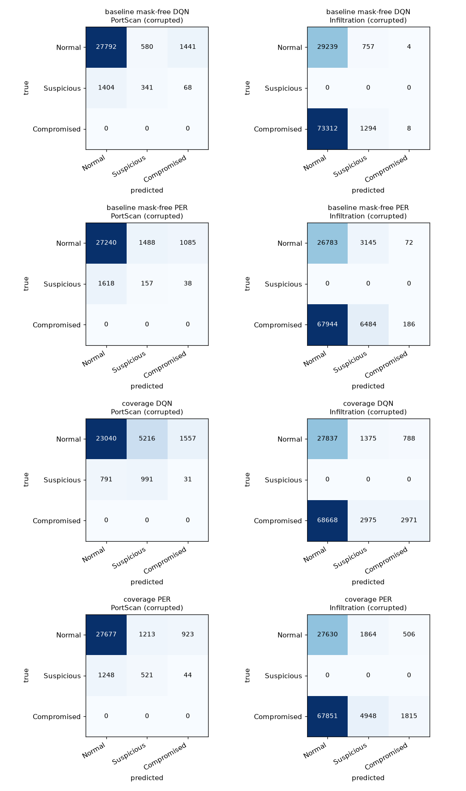

# Coverage ablation - does adding the missing concepts help?

`data/processed/coverage_ablation_report.md` - generated by `PYTHONPATH=src python -m rl_ids.coverage_eval`

## 1. Question

The mask-free agents fail on 2018 `Infilteration` (recall ~0.02) and only partially catch 2017 `PortScan` (recall ~0.41). The diagnosis (`dataset_preprocessing_report.md`, `coverage_split_report.md`) is missing **training coverage**: the train split contains **no PortScan** and only **36 Infiltration rows** (vs 137,720 in the 2018 holdout). This experiment adds the missing concepts and asks whether recall rises.

This is a **purely additive** test: `train.parquet` and the original holdouts are untouched, and the baseline agents (trained without coverage) are kept and scored on the *same* new test sets.

## 2. Method

- Training corpus = `train.parquet` (+) `coverage_train.parquet` (PortScan-day 80% + Wed-28 Infilteration), RNG-shuffled.
- Coverage agents retrained with the **same** network, episodes, seed and pool cap as the baseline mask-free agents; **only the data changed**.
- Baseline and coverage agents scored on identical unseen test sets, using the agent's own greedy action as the decision (no mask, no label leak).
- Q-values average 4 env-style observations under corrupted telemetry; also reported clean.
- Test benign traffic capped at 30,000 rows (FPR estimate); **all** attack rows kept.

## 3. Test sets

| Test set | Rows | Composition | Attack rows | Benign rows |
|---|---:|---|---:|---:|
| PortScan test (2017) | 31,626 | Normal 29,813, Suspicious 1,813 | 1,813 | 29,813 |
| Infiltration test (2018) | 104,614 | Compromised 74,614, Normal 30,000 | 74,614 | 30,000 |

PortScan test is a **within-day temporal split** (last 20% of the PortScan day), so it shares a day with the PortScan training portion and is an optimistic bound; Infiltration test is a **separate day** (Thu-01 vs Wed-28) and is clean. Both remain unseen by every model.

## 4. Headline - attack-label recall (corrupted observations)

| Test set | Attack label | Model | Recall | Precision | F1 | Benign FPR |
|---|---|---|---:|---:|---:|---:|
| PortScan | PortScan | baseline mask-free DQN | 0.226 | 0.168 | 0.193 | 0.068 |
| PortScan | PortScan | baseline mask-free PER | 0.108 | 0.070 | 0.085 | 0.086 |
| PortScan | PortScan | **coverage DQN** | 0.564 | 0.131 | 0.213 | 0.227 |
| PortScan | PortScan | **coverage PER** | 0.312 | 0.209 | 0.250 | 0.072 |
| Infiltration | Infilteration | baseline mask-free DQN | 0.017 | 0.631 | 0.034 | 0.025 |
| Infiltration | Infilteration | baseline mask-free PER | 0.089 | 0.675 | 0.158 | 0.107 |
| Infiltration | Infilteration | **coverage DQN** | 0.080 | 0.733 | 0.144 | 0.072 |
| Infiltration | Infilteration | **coverage PER** | 0.091 | 0.741 | 0.162 | 0.079 |

### Per-architecture delta (same net, seed, episodes - only the data changed)

| Test set | Attack label | Architecture | Baseline recall | Coverage recall | Δ recall | Baseline FPR | Coverage FPR |
|---|---|---|---:|---:|---:|---:|---:|
| PortScan | PortScan | DQN | 0.226 | 0.564 | +0.338 | 0.068 | 0.227 |
| PortScan | PortScan | PER | 0.108 | 0.312 | +0.204 | 0.086 | 0.072 |
| Infiltration | Infilteration | DQN | 0.017 | 0.080 | +0.062 | 0.025 | 0.072 |
| Infiltration | Infilteration | PER | 0.089 | 0.091 | +0.001 | 0.107 | 0.079 |

### Clean observations (context)

| Test set | Attack label | Model | Recall | F1 | Benign FPR |
|---|---|---|---:|---:|---:|
| PortScan | PortScan | baseline mask-free DQN | 0.249 | 0.188 | 0.085 |
| PortScan | PortScan | baseline mask-free PER | 0.124 | 0.084 | 0.110 |
| PortScan | PortScan | coverage DQN | 0.662 | 0.201 | 0.299 |
| PortScan | PortScan | coverage PER | 0.440 | 0.264 | 0.115 |
| Infiltration | Infilteration | baseline mask-free DQN | 0.027 | 0.051 | 0.049 |
| Infiltration | Infilteration | baseline mask-free PER | 0.065 | 0.118 | 0.081 |
| Infiltration | Infilteration | coverage DQN | 0.093 | 0.165 | 0.092 |
| Infiltration | Infilteration | coverage PER | 0.135 | 0.228 | 0.122 |

*Figure: confusion matrices under corrupted observations (rows = true severity bucket, cols = predicted). Top two rows = baseline, bottom two = coverage.*

## 5. Bucket-level detail (corrupted)

### PortScan test (2017)

Bucket recall for the attack class **Suspicious**, per model.

- **baseline mask-free DQN** - Suspicious recall 0.188, precision 0.370, F1 0.249; macro F1 0.397; benign FPR 0.068.
- **baseline mask-free PER** - Suspicious recall 0.087, precision 0.095, F1 0.091; macro F1 0.340; benign FPR 0.086.
- **coverage DQN** - Suspicious recall 0.547, precision 0.160, F1 0.247; macro F1 0.369; benign FPR 0.227.
- **coverage PER** - Suspicious recall 0.287, precision 0.300, F1 0.294; macro F1 0.412; benign FPR 0.072.

### Infiltration test (2018)

Bucket recall for the attack class **Compromised**, per model.

- **baseline mask-free DQN** - Compromised recall 0.000, precision 0.667, F1 0.000; macro F1 0.147; benign FPR 0.025.
- **baseline mask-free PER** - Compromised recall 0.002, precision 0.721, F1 0.005; macro F1 0.145; benign FPR 0.107.
- **coverage DQN** - Compromised recall 0.040, precision 0.790, F1 0.076; macro F1 0.172; benign FPR 0.072.
- **coverage PER** - Compromised recall 0.024, precision 0.782, F1 0.047; macro F1 0.163; benign FPR 0.079.

## 6. Reading the result

### PortScan test (2017) - `PortScan`

- **DQN**: recall 0.226 -> 0.564 (+0.338); benign FPR 0.068 -> 0.227 (+0.159).
- **PER**: recall 0.108 -> 0.312 (+0.204); benign FPR 0.086 -> 0.072 (-0.015).

### Infiltration test (2018) - `Infilteration`

- **DQN**: recall 0.017 -> 0.080 (+0.062); benign FPR 0.025 -> 0.072 (+0.047).
- **PER**: recall 0.089 -> 0.091 (+0.001); benign FPR 0.107 -> 0.079 (-0.028).

### What it means

- **PortScan: coverage is the fix.** With training coverage the recall jumps in both architectures - DQN 0.226 -> 0.564 (+0.338), PER 0.108 -> 0.312 (+0.204) - on a family that had **zero** training rows before. The diagnosis (missing concept) is confirmed: for a truly absent family, adding it is what moves detection.
- **Read the FPR together with the recall.** The DQN's PortScan gain costs a false-alarm rise (0.068 -> 0.227), while PER buys a comparable recall jump at ~flat FPR (0.086 -> 0.072). So *which agent consumes the new coverage* matters: PER turns it into recall without turning it into false alarms.
- **Infiltration: coverage helps less, and representation is why.** It was added but stays a small share of the Compromised pool: DQN recall 0.017 -> 0.080 (+0.062), PER 0.089 -> 0.091 (+0.001). Existence was necessary but not sufficient - at natural proportion the concept is too diluted to dominate the DDoS/DoS mass, so the binding constraint has shifted from *coverage* to *representation*.
- **The original mask-free results remain the honest out-of-distribution baseline** (`maskfree_holdout_detection_report.md`); the coverage agents are the in-coverage counterpart and are only directly comparable on these test sets.
