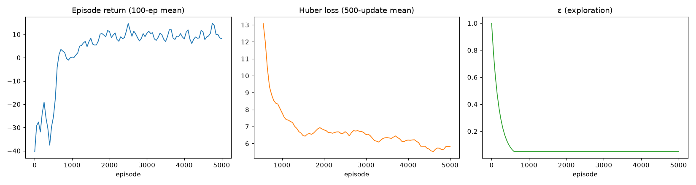

# Coverage-ablation Double DQN - training report

`data/processed/coverage_dqn_report.md` - generated by `PYTHONPATH=src python -m rl_ids.train_coverage`

## 1. Setup

- Train corpus = `train.parquet` (+) `coverage_train.parquet` (PortScan-day 80% + Wed-28 Infilteration), RNG-shuffled, seed 7.
- Environment: `IDSEnv2018(mask_actions=False)`, 17-feature real-flow observations with noise + telemetry masking (same as the mask-free phase).
- **Only the data changed**: same network, episodes, seed and pool cap as the no-coverage mask-free run (all actions offered, no mask).
- Episodes = 5,000, steps = 21,861, updates = 19,862; pool cap = 200,000/state; γ = 0.9.

## 2. Added corpus & what the agent actually sees

| State | Added rows | Corpus total | In pool (after cap) | New concept in pool |
|---|---:|---:|---:|---|
| Normal | 429,414 | 14,779,436 | 200,000 | — |
| Suspicious | 3,372 | 171,373 | 171,373 | 3,372 PortScan |
| Compromised | 63,106 | 2,293,208 | 200,000 | 5,492 Infilteration |

Added rows are the coverage concepts; the new concept must survive the per-state `head()` cap (asserted at train time) or the ablation would be silently comparing against no added data at all.

## 3. Learned policy

| Start state | Dominant greedy action | Expected optimal | Match |
|---|---|---|---|
| Normal | Monitor | Monitor | yes |
| Suspicious | Honeypot | Honeypot | yes |
| Compromised | Block | Block | yes |

## 4. Returns: coverage Double DQN vs random vs optimum

| Start state | Coverage greedy | Random | Exact optimum | No-coverage mask-free |
|---|---|---|---|---|
| Normal | +2.879 ± 10.20 | -33.033 | +8.721 | +6.542 |
| Suspicious | +18.874 ± 20.15 | -10.308 | +23.163 | +20.095 |
| Compromised | +11.977 ± 9.40 | -21.968 | +14.508 | +12.996 |

The coverage return is scored on the **augmented** pool, the no-coverage figure on the original pool, so the gap mixes a harder pool with any change in competence - both agents still recover the same playbook policy (section 3). Detection (the point of the ablation) is measured on identical test sets in `coverage_ablation_report.md`.

## 5. Training dynamics

- Final ε = 0.05000.
- Mean Huber loss (last tracked points) = 5.6982.
- Mean episode return (last point) = +8.152.
- Learning curve: `coverage_dqn_learning_curve.png`

## 6. Files

| File | Purpose |
|---|---|
| `src/rl_ids/coverage_split.py` | builds the coverage corpus |
| `src/rl_ids/train_coverage.py` | this driver |
| `models/double_dqn_coverage.pt` | trained online-network weights (git-ignored) |
| `data/processed/coverage_dqn_report.md` | this report |
| `data/processed/coverage_dqn_learning_curve.png` | learning curve |