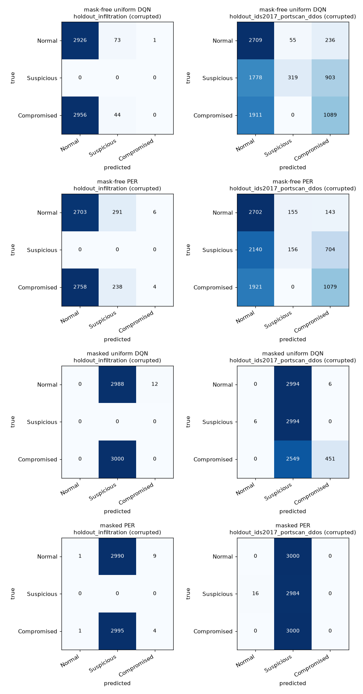

# Mask-free holdout detection - policy action as the decision

`data/processed/maskfree_holdout_detection_report.md` - generated by `PYTHONPATH=src python -m rl_ids.maskfree_detect`

## 1. Why this is a real detection metric

In the masked phase the action mask *is* the label in disguise, so the agent's actions could not be scored directly (see `holdout_classification_report.md`). In the **mask-free** phase the mask is gone: every action is offered in every state and the agent was trained to pick the right one without being told the hidden bucket. Its greedy action therefore *is* a detection decision, and the Q-argmax over all actions is a genuine classifier.

The masked agents are included as a contrast: their mask-free Q-argmax was never forced to encode the state (the mask always supplied it), so it collapses toward the majority bucket without raising attack alarms.

## 2. Method

- Decision: `argmax_a Q(s, a)` over **all six** actions, no mask.
- Action -> implied bucket: Monitor -> Normal; DPI/Throttle/Honeypot -> Suspicious; Block/Isolate -> Compromised (same `action_bucket` mapping as the masked phase).
- Q-values average 4 env-style observations (Gaussian noise sigma=0.05, telemetry masking p=0.1).
- Holdouts sampled at 3,000/class; observations **clean** and **corrupted**.
- Predicted-attack = bucket != Normal; FPR is one-vs-rest per row; the operational false-alarm rate on benign traffic is the `_benign FP rate_` row.

## 3. Headline (corrupted observations)

| Model | Holdout | Accuracy | Macro F1 | Mean attack recall | Benign FPR |
|---|---|---:|---:|---:|---:|
| mask-free uniform DQN | holdout_infiltration (2018) | 0.488 | 0.220 | 0.015 | 0.025 |
| mask-free uniform DQN | holdout_ids2017_portscan_ddos (2017) | 0.457 | 0.394 | 0.385 | 0.097 |
| mask-free PER | holdout_infiltration (2018) | 0.451 | 0.214 | 0.081 | 0.099 |
| mask-free PER | holdout_ids2017_portscan_ddos (2017) | 0.437 | 0.362 | 0.323 | 0.099 |
| masked uniform DQN | holdout_infiltration (2018) | 0.000 | 0.000 | 1.000 | 1.000 |
| masked uniform DQN | holdout_ids2017_portscan_ddos (2017) | 0.383 | 0.260 | 0.999 | 1.000 |
| masked PER | holdout_infiltration (2018) | 0.001 | 0.001 | 1.000 | 1.000 |
| masked PER | holdout_ids2017_portscan_ddos (2017) | 0.332 | 0.166 | 0.997 | 1.000 |

*Figure: confusion matrices under corrupted observations (rows = true severity bucket, cols = predicted).*

### Attack-label detection (corrupted)

| Model | Holdout | Attack label | Precision | Recall | F1 |
|---|---|---|---:|---:|---:|
| mask-free uniform DQN | holdout_infiltration | Infilteration | 0.373 | 0.015 | 0.028 |
| mask-free uniform DQN | holdout_ids2017_portscan_ddos | DDoS | 0.789 | 0.363 | 0.497 |
| mask-free uniform DQN | holdout_ids2017_portscan_ddos | PortScan | 0.808 | 0.407 | 0.542 |
| mask-free PER | holdout_infiltration | Infilteration | 0.449 | 0.081 | 0.137 |
| mask-free PER | holdout_ids2017_portscan_ddos | DDoS | 0.784 | 0.360 | 0.493 |
| mask-free PER | holdout_ids2017_portscan_ddos | PortScan | 0.743 | 0.287 | 0.414 |
| masked uniform DQN | holdout_infiltration | Infilteration | 0.500 | 1.000 | 0.667 |
| masked uniform DQN | holdout_ids2017_portscan_ddos | DDoS | 0.500 | 1.000 | 0.667 |
| masked uniform DQN | holdout_ids2017_portscan_ddos | PortScan | 0.499 | 0.998 | 0.666 |
| masked PER | holdout_infiltration | Infilteration | 0.500 | 1.000 | 0.667 |
| masked PER | holdout_ids2017_portscan_ddos | DDoS | 0.500 | 1.000 | 0.667 |
| masked PER | holdout_ids2017_portscan_ddos | PortScan | 0.499 | 0.995 | 0.664 |

## 4. Per-model detail

### holdout_infiltration (2018)

6,000 flows (Compromised 3,000, Normal 3,000).

**mask-free uniform DQN**

_Observations: clean._ Bucket accuracy **0.479**.

| Class | Precision | Recall | F1 | FPR | Support |
|---|---:|---:|---:|---:|---:|
| Normal | 0.495 | 0.958 | 0.653 | 0.978 | 3,000 |
| Suspicious | 0.000 | 0.000 | 0.000 | 0.032 | 0 |
| Compromised | 0.000 | 0.000 | 0.000 | 0.000 | 3,000 |
| **macro** | 0.165 | 0.319 | 0.218 | - | 6,000 |

| Attack label | Precision | Recall | F1 | FPR | Support |
|---|---:|---:|---:|---:|---:|
| Infilteration | 0.345 | 0.022 | 0.042 | 0.042 | 3,000 |
| _benign FP rate_ | - | - | - | 0.042 | 3,000 benign |

_Observations: corrupted._ Bucket accuracy **0.488**.

| Class | Precision | Recall | F1 | FPR | Support |
|---|---:|---:|---:|---:|---:|
| Normal | 0.497 | 0.975 | 0.659 | 0.985 | 3,000 |
| Suspicious | 0.000 | 0.000 | 0.000 | 0.019 | 0 |
| Compromised | 0.000 | 0.000 | 0.000 | 0.000 | 3,000 |
| **macro** | 0.166 | 0.325 | 0.220 | - | 6,000 |

| Attack label | Precision | Recall | F1 | FPR | Support |
|---|---:|---:|---:|---:|---:|
| Infilteration | 0.373 | 0.015 | 0.028 | 0.025 | 3,000 |
| _benign FP rate_ | - | - | - | 0.025 | 3,000 benign |

**mask-free PER**

_Observations: clean._ Bucket accuracy **0.463**.

| Class | Precision | Recall | F1 | FPR | Support |
|---|---:|---:|---:|---:|---:|
| Normal | 0.495 | 0.923 | 0.644 | 0.943 | 3,000 |
| Suspicious | 0.000 | 0.000 | 0.000 | 0.064 | 0 |
| Compromised | 0.500 | 0.003 | 0.005 | 0.003 | 3,000 |
| **macro** | 0.332 | 0.309 | 0.216 | - | 6,000 |

| Attack label | Precision | Recall | F1 | FPR | Support |
|---|---:|---:|---:|---:|---:|
| Infilteration | 0.424 | 0.057 | 0.100 | 0.077 | 3,000 |
| _benign FP rate_ | - | - | - | 0.077 | 3,000 benign |

_Observations: corrupted._ Bucket accuracy **0.451**.

| Class | Precision | Recall | F1 | FPR | Support |
|---|---:|---:|---:|---:|---:|
| Normal | 0.495 | 0.901 | 0.639 | 0.919 | 3,000 |
| Suspicious | 0.000 | 0.000 | 0.000 | 0.088 | 0 |
| Compromised | 0.400 | 0.001 | 0.003 | 0.002 | 3,000 |
| **macro** | 0.298 | 0.301 | 0.214 | - | 6,000 |

| Attack label | Precision | Recall | F1 | FPR | Support |
|---|---:|---:|---:|---:|---:|
| Infilteration | 0.449 | 0.081 | 0.137 | 0.099 | 3,000 |
| _benign FP rate_ | - | - | - | 0.099 | 3,000 benign |

**masked uniform DQN**

_Observations: clean._ Bucket accuracy **0.000**.

| Class | Precision | Recall | F1 | FPR | Support |
|---|---:|---:|---:|---:|---:|
| Normal | 0.000 | 0.000 | 0.000 | 0.000 | 3,000 |
| Suspicious | 0.000 | 0.000 | 0.000 | 0.998 | 0 |
| Compromised | 0.000 | 0.000 | 0.000 | 0.005 | 3,000 |
| **macro** | 0.000 | 0.000 | 0.000 | - | 6,000 |

| Attack label | Precision | Recall | F1 | FPR | Support |
|---|---:|---:|---:|---:|---:|
| Infilteration | 0.500 | 1.000 | 0.667 | 1.000 | 3,000 |
| _benign FP rate_ | - | - | - | 1.000 | 3,000 benign |

_Observations: corrupted._ Bucket accuracy **0.000**.

| Class | Precision | Recall | F1 | FPR | Support |
|---|---:|---:|---:|---:|---:|
| Normal | 0.000 | 0.000 | 0.000 | 0.000 | 3,000 |
| Suspicious | 0.000 | 0.000 | 0.000 | 0.998 | 0 |
| Compromised | 0.000 | 0.000 | 0.000 | 0.004 | 3,000 |
| **macro** | 0.000 | 0.000 | 0.000 | - | 6,000 |

| Attack label | Precision | Recall | F1 | FPR | Support |
|---|---:|---:|---:|---:|---:|
| Infilteration | 0.500 | 1.000 | 0.667 | 1.000 | 3,000 |
| _benign FP rate_ | - | - | - | 1.000 | 3,000 benign |

**masked PER**

_Observations: clean._ Bucket accuracy **0.000**.

| Class | Precision | Recall | F1 | FPR | Support |
|---|---:|---:|---:|---:|---:|
| Normal | 0.500 | 0.000 | 0.001 | 0.000 | 3,000 |
| Suspicious | 0.000 | 0.000 | 0.000 | 0.999 | 0 |
| Compromised | 0.000 | 0.000 | 0.000 | 0.001 | 3,000 |
| **macro** | 0.167 | 0.000 | 0.000 | - | 6,000 |

| Attack label | Precision | Recall | F1 | FPR | Support |
|---|---:|---:|---:|---:|---:|
| Infilteration | 0.500 | 1.000 | 0.667 | 1.000 | 3,000 |
| _benign FP rate_ | - | - | - | 1.000 | 3,000 benign |

_Observations: corrupted._ Bucket accuracy **0.001**.

| Class | Precision | Recall | F1 | FPR | Support |
|---|---:|---:|---:|---:|---:|
| Normal | 0.500 | 0.000 | 0.001 | 0.000 | 3,000 |
| Suspicious | 0.000 | 0.000 | 0.000 | 0.998 | 0 |
| Compromised | 0.308 | 0.001 | 0.003 | 0.003 | 3,000 |
| **macro** | 0.269 | 0.001 | 0.001 | - | 6,000 |

| Attack label | Precision | Recall | F1 | FPR | Support |
|---|---:|---:|---:|---:|---:|
| Infilteration | 0.500 | 1.000 | 0.667 | 1.000 | 3,000 |
| _benign FP rate_ | - | - | - | 1.000 | 3,000 benign |

### holdout_ids2017_portscan_ddos (2017)

9,000 flows (Compromised 3,000, Normal 3,000, Suspicious 3,000).

**mask-free uniform DQN**

_Observations: clean._ Bucket accuracy **0.456**.

| Class | Precision | Recall | F1 | FPR | Support |
|---|---:|---:|---:|---:|---:|
| Normal | 0.422 | 0.880 | 0.570 | 0.603 | 3,000 |
| Suspicious | 0.795 | 0.126 | 0.218 | 0.016 | 3,000 |
| Compromised | 0.479 | 0.361 | 0.412 | 0.197 | 3,000 |
| **macro** | 0.565 | 0.456 | 0.400 | - | 9,000 |

| Attack label | Precision | Recall | F1 | FPR | Support |
|---|---:|---:|---:|---:|---:|
| DDoS | 0.751 | 0.361 | 0.488 | 0.120 | 3,000 |
| PortScan | 0.783 | 0.433 | 0.557 | 0.120 | 3,000 |
| _benign FP rate_ | - | - | - | 0.120 | 3,000 benign |

_Observations: corrupted._ Bucket accuracy **0.457**.

| Class | Precision | Recall | F1 | FPR | Support |
|---|---:|---:|---:|---:|---:|
| Normal | 0.423 | 0.903 | 0.577 | 0.615 | 3,000 |
| Suspicious | 0.853 | 0.106 | 0.189 | 0.009 | 3,000 |
| Compromised | 0.489 | 0.363 | 0.417 | 0.190 | 3,000 |
| **macro** | 0.588 | 0.457 | 0.394 | - | 9,000 |

| Attack label | Precision | Recall | F1 | FPR | Support |
|---|---:|---:|---:|---:|---:|
| DDoS | 0.789 | 0.363 | 0.497 | 0.097 | 3,000 |
| PortScan | 0.808 | 0.407 | 0.542 | 0.097 | 3,000 |
| _benign FP rate_ | - | - | - | 0.097 | 3,000 benign |

**mask-free PER**

_Observations: clean._ Bucket accuracy **0.436**.

| Class | Precision | Recall | F1 | FPR | Support |
|---|---:|---:|---:|---:|---:|
| Normal | 0.410 | 0.886 | 0.561 | 0.637 | 3,000 |
| Suspicious | 0.528 | 0.060 | 0.108 | 0.027 | 3,000 |
| Compromised | 0.498 | 0.361 | 0.419 | 0.182 | 3,000 |
| **macro** | 0.479 | 0.436 | 0.363 | - | 9,000 |

| Attack label | Precision | Recall | F1 | FPR | Support |
|---|---:|---:|---:|---:|---:|
| DDoS | 0.760 | 0.361 | 0.490 | 0.114 | 3,000 |
| PortScan | 0.762 | 0.365 | 0.494 | 0.114 | 3,000 |
| _benign FP rate_ | - | - | - | 0.114 | 3,000 benign |

_Observations: corrupted._ Bucket accuracy **0.437**.

| Class | Precision | Recall | F1 | FPR | Support |
|---|---:|---:|---:|---:|---:|
| Normal | 0.400 | 0.901 | 0.554 | 0.677 | 3,000 |
| Suspicious | 0.502 | 0.052 | 0.094 | 0.026 | 3,000 |
| Compromised | 0.560 | 0.360 | 0.438 | 0.141 | 3,000 |
| **macro** | 0.487 | 0.437 | 0.362 | - | 9,000 |

| Attack label | Precision | Recall | F1 | FPR | Support |
|---|---:|---:|---:|---:|---:|
| DDoS | 0.784 | 0.360 | 0.493 | 0.099 | 3,000 |
| PortScan | 0.743 | 0.287 | 0.414 | 0.099 | 3,000 |
| _benign FP rate_ | - | - | - | 0.099 | 3,000 benign |

**masked uniform DQN**

_Observations: clean._ Bucket accuracy **0.388**.

| Class | Precision | Recall | F1 | FPR | Support |
|---|---:|---:|---:|---:|---:|
| Normal | 0.000 | 0.000 | 0.000 | 0.001 | 3,000 |
| Suspicious | 0.353 | 0.998 | 0.521 | 0.915 | 3,000 |
| Compromised | 0.976 | 0.165 | 0.283 | 0.002 | 3,000 |
| **macro** | 0.443 | 0.388 | 0.268 | - | 9,000 |

| Attack label | Precision | Recall | F1 | FPR | Support |
|---|---:|---:|---:|---:|---:|
| DDoS | 0.500 | 1.000 | 0.667 | 1.000 | 3,000 |
| PortScan | 0.499 | 0.998 | 0.666 | 1.000 | 3,000 |
| _benign FP rate_ | - | - | - | 1.000 | 3,000 benign |

_Observations: corrupted._ Bucket accuracy **0.383**.

| Class | Precision | Recall | F1 | FPR | Support |
|---|---:|---:|---:|---:|---:|
| Normal | 0.000 | 0.000 | 0.000 | 0.001 | 3,000 |
| Suspicious | 0.351 | 0.998 | 0.519 | 0.924 | 3,000 |
| Compromised | 0.987 | 0.150 | 0.261 | 0.001 | 3,000 |
| **macro** | 0.446 | 0.383 | 0.260 | - | 9,000 |

| Attack label | Precision | Recall | F1 | FPR | Support |
|---|---:|---:|---:|---:|---:|
| DDoS | 0.500 | 1.000 | 0.667 | 1.000 | 3,000 |
| PortScan | 0.499 | 0.998 | 0.666 | 1.000 | 3,000 |
| _benign FP rate_ | - | - | - | 1.000 | 3,000 benign |

**masked PER**

_Observations: clean._ Bucket accuracy **0.332**.

| Class | Precision | Recall | F1 | FPR | Support |
|---|---:|---:|---:|---:|---:|
| Normal | 0.000 | 0.000 | 0.000 | 0.003 | 3,000 |
| Suspicious | 0.332 | 0.995 | 0.498 | 1.000 | 3,000 |
| Compromised | 0.000 | 0.000 | 0.000 | 0.000 | 3,000 |
| **macro** | 0.111 | 0.332 | 0.166 | - | 9,000 |

| Attack label | Precision | Recall | F1 | FPR | Support |
|---|---:|---:|---:|---:|---:|
| DDoS | 0.500 | 1.000 | 0.667 | 1.000 | 3,000 |
| PortScan | 0.499 | 0.995 | 0.664 | 1.000 | 3,000 |
| _benign FP rate_ | - | - | - | 1.000 | 3,000 benign |

_Observations: corrupted._ Bucket accuracy **0.332**.

| Class | Precision | Recall | F1 | FPR | Support |
|---|---:|---:|---:|---:|---:|
| Normal | 0.000 | 0.000 | 0.000 | 0.003 | 3,000 |
| Suspicious | 0.332 | 0.995 | 0.498 | 1.000 | 3,000 |
| Compromised | 0.000 | 0.000 | 0.000 | 0.000 | 3,000 |
| **macro** | 0.111 | 0.332 | 0.166 | - | 9,000 |

| Attack label | Precision | Recall | F1 | FPR | Support |
|---|---:|---:|---:|---:|---:|
| DDoS | 0.500 | 1.000 | 0.667 | 1.000 | 3,000 |
| PortScan | 0.499 | 0.995 | 0.664 | 1.000 | 3,000 |
| _benign FP rate_ | - | - | - | 1.000 | 3,000 benign |

## 5. Reading the results

**Benign FPR is the decisive column.** A degenerate detector that flags *every* flow as an attack can still post a non-zero macro F1 when attacks dominate a holdout - which is exactly what the masked agents do (benign FPR = 1.000). They raise an alarm on every benign flow, so their macro F1 is meaningless. Only the mask-free agents separate benign from attack.

- **holdout_infiltration (2018)** - best mask-free agent: **mask-free uniform DQN** (macro F1 0.220 at benign FPR 0.025); best masked agent mask-free argmax: masked PER (macro F1 0.001 at benign FPR 1.000 - degenerate).
- **holdout_ids2017_portscan_ddos (2017)** - best mask-free agent: **mask-free uniform DQN** (macro F1 0.394 at benign FPR 0.097); best masked agent mask-free argmax: masked uniform DQN (macro F1 0.260 at benign FPR 1.000 - degenerate).

**2018 `Infilteration` is the weak case.** The mask-free agents are conservative (benign FPR 0.025-0.099) but catch almost none of the `Infilteration` rows (recall 0.015-0.081): the family has effectively no training counterpart (only 36 rows of the 2017-spelled `Infiltration` in the train split), so there is nothing to transfer. Read the 2018 macro F1 together with the recall column - it is dominated by the benign class.
**2017 is the positive case.** With no mask, the same agent that recovers the optimal policy detects `DDoS` (recall ~0.36) and `PortScan` (recall ~0.41) at a ~0.10 benign false-alarm rate - a real, non-circular IDS result, and a far better operating point than the masked agents' flag-everything behaviour.
**Unseen label strings still transfer when the family is known.** The 2017 `DDoS` label never appears in training, but the family does as ~1.24M 2018 `HOIC`/`LOIC` rows in the `Compromised` bucket; `Infilteration` has no such counterpart and is not detected. Coverage, not tuning, sets the ceiling.

## 6. Files

| File | Purpose |
|---|---|
| `src/rl_ids/train_maskfree.py` | trains the mask-free agents |
| `src/rl_ids/maskfree_detect.py` | this driver |
| `src/rl_ids/metrics.py` | pure per-class / binary metric functions |
| `data/processed/maskfree_holdout_detection_report.md` | this report |
| `data/processed/maskfree_holdout_confusion_matrix.png` | confusion matrices |