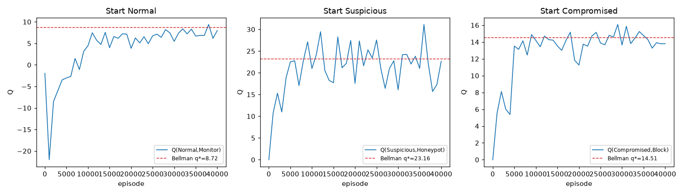

# Mask-free tabular control - sanity check report

`data/processed/maskfree_tabular_report.md` - generated by `PYTHONPATH=src python -m rl_ids.train_tabular_maskfree`

## 1. Setup

- World: 3-state tabular bucketing of `IDSEnv2018(mask_actions=False)` (agent uses `info["mdp_state"]` - perfect state perception).
- **Every one of the 6 actions is available in every state** (no playbook mask); the reward is total over the 3x6 table.
- Algorithm: **First-Visit Constant-α GLIE MC control**; γ = 0.9, α = 0.05, ε_t = 1/(1 + t/1000) (ends at ε = 0.0244).
- Explore-starts uniform over the hidden buckets; episodes = 40000; seed = 11.

## 2. Learned policy

| Start state | Learned greedy action | Expected playbook | Match |
|---|---|---|---|
| Normal | Monitor | Monitor | yes |
| Suspicious | Honeypot | Honeypot | yes |
| Compromised | Block | Block | yes |

With the mask removed the MC agent still lands on the playbook in every state - the off-playbook actions are all strictly dominated (Section 3).

## 3. Q-values over all actions: MC vs exact Bellman

| State | Action | MC-learned Q | Unbiased eval (greedy) | Bellman q* |
|---|---|---|---|---|
| Normal | Monitor **(playbook)** | +7.975 | +8.777±5.17 | +8.721 |
| Normal | DPI | +5.193 | – | +7.721 |
| Normal | Throttle | +4.362 | – | +7.221 |
| Normal | Honeypot | -3.815 | – | -6.279 |
| Normal | Block | -8.118 | – | -5.279 |
| Normal | Isolate | -27.000 | – | -27.000 |
| Suspicious | Monitor | +15.074 | – | +17.204 |
| Suspicious | DPI | +13.653 | – | +15.935 |
| Suspicious | Throttle | +5.352 | – | +4.827 |
| Suspicious | Honeypot **(playbook)** | +22.644 | +23.618±21.96 | +23.163 |
| Suspicious | Block | +12.657 | – | +14.950 |
| Suspicious | Isolate | -27.000 | – | -27.000 |
| Compromised | Monitor | +8.243 | – | +11.751 |
| Compromised | DPI | -18.507 | – | -21.202 |
| Compromised | Throttle | -13.560 | – | -12.713 |
| Compromised | Honeypot | -9.667 | – | -11.966 |
| Compromised | Block **(playbook)** | +13.803 | +14.438±4.57 | +14.508 |
| Compromised | Isolate | +3.000 | – | +3.000 |

- The playbook action has the **strict maximum** in every state, under both MC control and the exact Bellman solution.
- Off-playbook actions are clearly worse: e.g. `Block`/`Isolate` on `Normal` (false positives) and `DPI`/`Throttle`/`Honeypot` on `Compromised` (too soft, false negatives).

## 4. Stabilization & learning curve

- Final ε = 0.02439.
- Max |ΔQ| over the last five 1k-episode snapshots (all 18 pairs) = **8.9872**.
- RMSE of the learned Q vs the mask-free Bellman exact = 1.984.
- Learning curve: `maskfree_tabular_learning_curve.png`

## 5. Verdict

Under the mask-free MDP the tabular agent converges to the **same optimal policy** and its q* tracks the exact Bellman solution (`N 8.721 / S 23.163 / C 14.508`, unchanged from the masked phase). The env and reward are sound when every action is offered - green light for the mask-free Double DQN / PER runs.
