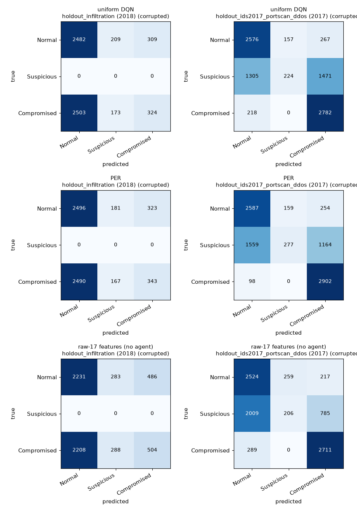

# Holdout Detection Evaluation

> **Goal:** measure **per-class precision / recall / F1 / FPR** for the trained
> Double DQN and PER agents on the two **untouched, eval-only holdout days** —
> without retraining anything, and without the evaluation being circular.
>
> Artifacts: `src/rl_ids/metrics.py`, `src/rl_ids/holdout_eval.py`,
> `tests/test_holdout_metrics.py`,
> `data/processed/holdout_classification_report.md`,
> `data/processed/holdout_confusion_matrix.png`.

---

## 1. The problem: the action mask leaks the label

Each flow arrives at the agent with `info["action_mask"]`, the playbook mask of
legal actions. Because the three masks are **pairwise disjoint**, the mask is
perfectly correlated with the hidden severity bucket:

| Hidden bucket | Legal actions (mask) |
|---|---|
| Normal | `Monitor` |
| Suspicious | `Monitor, DPI, Throttle, Honeypot` |
| Compromised | `Monitor, Block, Isolate` |

So the mask is the ground-truth label wearing a disguise. Two obvious readings of
the agent's actions both fail, and both are measured as **negative controls**
(Section 3):

- **Mask supplied (circular).** Give the responder the true-state mask. It reads
  the state straight out of the mask and gets **0.999 accuracy — by construction**.
  That number measures the mask, not the network.
- **Mask-free Q-argmax (useless).** Take the mask away and argmax `Q` directly.
  It collapses to **0.199–0.230 accuracy**, mostly predicting one bucket for
  everything. The Double-DQN update was never forced to encode the state in its
  outputs, because the mask always removed the wrong actions before the argmax.

Neither is a usable detection metric. A third reading gives an honest one.

## 2. Method: probe the learned representation

A **logistic-regression probe** asks the real question — *is the information
there?* — instead of asking what the policy happens to do:

```
frozen 128-d penultimate layer of Q_online ──► StandardScaler ──► LogisticRegression
        (train split only)                                          │
                                                                    ▼
                                              predict on the untouched holdouts
```

- **Train fit:** a stratified sample of `train.parquet` (4 000 flows per
  bucket) — the same split the agents learned from, **never** the holdouts.
- **Holdouts:** `holdout_infiltration.parquet` (2018) and
  `holdout_ids2017_portscan_ddos.parquet` (2017), sampled 3 000 flows per bucket
  so precision/recall are not inflated by class imbalance.
- **Observations:** `clean` (scaled features untouched) and `corrupted`
  (Gaussian noise σ = 0.05 + per-feature telemetry masking p = 0.1, exactly as
  `IDSEnv2018._sample_obs` does). Decisions average **4** such draws per flow.
- **Baseline:** the same probe on the **raw 17 features**, i.e. with no agent
  involved — this is what the representation must beat to be worth anything.
- **Predicted attack** = predicted bucket `≠ Normal`.

Both checkpoints (`double_dqn.pt`, `double_dqn_per.pt`) are evaluated under both
observation conditions; all three trajectories share the config, env and seed.

## 3. Negative controls

| Model | Mask supplied (circular) | Mask-free Q-argmax | Random action |
|---|---:|---:|---:|
| uniform DQN | 0.999 | 0.230 | 0.299 |
| PER | 0.999 | 0.199 | 0.299 |

Mask-supplied accuracy is ~1.0 because it is handed the answer; mask-free
Q-argmax is no better than chance at reading a hidden state it was never trained
to read. This is exactly why Section 4 scores a probe rather than a policy.

## 4. Results

Probe **train** accuracy: uniform DQN 0.970 (clean) / 0.934 (corrupted), PER
0.963 / 0.934, raw-17 baseline 0.893 / 0.875. The gap between that and the
holdout scores below *is* the generalisation gap to unseen days and attacks.

### 4.1 Headline (corrupted observations)

| Model | Holdout | Accuracy | Macro F1 | Mean attack recall | Benign FPR |
|---|---|---:|---:|---:|---:|
| uniform DQN | holdout_infiltration (2018) | 0.468 | 0.267 | 0.166 | 0.173 |
| PER | holdout_infiltration (2018) | 0.473 | 0.271 | 0.170 | 0.168 |
| raw-17 features (no agent) | holdout_infiltration (2018) | 0.456 | 0.284 | 0.264 | 0.256 |
| uniform DQN | holdout_ids2017_portscan_ddos (2017) | 0.620 | 0.533 | 0.746 | 0.141 |
| PER | holdout_ids2017_portscan_ddos (2017) | 0.641 | 0.556 | 0.724 | 0.138 |
| raw-17 features (no agent) | holdout_ids2017_portscan_ddos (2017) | 0.605 | 0.524 | 0.617 | 0.159 |



### 4.2 Per attack label (corrupted)

`Infilteration` (2018 holdout) and `PortScan`/`DDoS` (2017 holdout), each scored
**label vs benign**:

| Holdout · label | Model | Precision | Recall | F1 | FPR |
|---|---|---:|---:|---:|---:|
| 2018 · Infilteration | uniform DQN | 0.490 | 0.166 | 0.248 | 0.173 |
| 2018 · Infilteration | PER | 0.503 | 0.170 | 0.254 | 0.168 |
| 2018 · Infilteration | raw-17 | 0.507 | 0.264 | 0.347 | 0.256 |
| 2017 · DDoS | uniform DQN | 0.868 | 0.927 | 0.897 | 0.141 |
| 2017 · DDoS | PER | 0.875 | 0.967 | 0.919 | 0.138 |
| 2017 · DDoS | raw-17 | 0.851 | 0.904 | 0.876 | 0.159 |
| 2017 · PortScan | uniform DQN | 0.800 | 0.565 | 0.662 | 0.141 |
| 2017 · PortScan | PER | 0.777 | 0.480 | 0.594 | 0.138 |
| 2017 · PortScan | raw-17 | 0.676 | 0.330 | 0.444 | 0.159 |

**Severity buckets** (PER, corrupted) — note `Suspicious` recall is the weak
spot, and the 2018 holdout contains no Suspicious flows at all:

| Holdout | Normal P/R/F1 | Suspicious P/R/F1 | Compromised P/R/F1 | Macro F1 |
|---|---|---|---|---:|
| 2018 · Infiltration | 0.501 / 0.832 / 0.625 | *(support 0)* | 0.515 / 0.114 / 0.187 | 0.271 |
| 2017 · PortScan+DDoS | 0.610 / 0.862 / 0.714 | 0.635 / 0.092 / 0.161 | 0.672 / 0.967 / 0.793 | 0.556 |

> **On FPR:** the metric is **one-vs-rest per row**, so the `Normal` row's FPR is
> the share of *attack* flows predicted benign (a miss rate). The operational
> **false-alarm rate on benign traffic** is the `_benign FP rate_` row in the
> generated report: **0.168–0.173** (2018) and **0.138–0.141** (2017) for the
> agents.

## 5. Reading the results

- **Family overlap drives recall.** The exact 2017 label strings `DDoS` and
  `PortScan` occur **zero** times in training, but the *DDoS family* does — some
  1.24 M rows of 2018 `DDOS attack-HOIC` / `LOIC-HTTP` traffic sit in the
  `Compromised` bucket the agents learned. That is why DDoS is recalled at
  **0.967** (F1 0.919) while `PortScan` (**0.480**) and `Infilteration`
  (**0.170**), which have no counterpart in training at all, are missed. The
  2018 holdout's label `Infilteration` is likewise absent (training contains only
  36 rows of the differently-spelled 2017 `Infiltration`).
- **The representation earns its keep where it had comparable data.** On the
  2017 holdout PER beats the raw-17 baseline by **+0.032 macro F1** and lifts
  PortScan recall 0.330 → 0.480. On the 2018 holdout — a single unseen family —
  no probe beats raw features, so there is nothing for the network to have
  learned. That is a **coverage limit, not a tuning bug**.
- **PER vs uniform is a trade, not a clean win.** PER takes macro F1
  **0.556 → 0.533** over uniform replay and lowers benign FPR (0.138 vs 0.141),
  but its *mean* attack recall is slightly lower (0.724 vs 0.746) because it
  shifts weight from PortScan (0.565 → 0.480) toward DDoS (0.927 → 0.967). The
  two agents sit within ~0.02 macro F1 of each other — far inside the noise of a
  probe on an unseen day.
- **Benign FPR stays near 0.14–0.17** on both holdouts rather than collapsing to
  zero — the probe is actually separating traffic, not trivially answering
  "benign".
- This report evaluates **perception**. The *policy* itself is unchanged and was
  already optimal on the training distribution (see the Double DQN and PER
  reports); the mask — and therefore the decision rule — was never the thing
  being measured here.

## 6. Metrics implemented

All in `src/rl_ids/metrics.py`, dependency-light (NumPy only) and unit-tested:

```
precision_c = TP / (TP + FP)       recall_c = TP / (TP + FN)
F1_c        = 2PR / (P + R)        FPR_c    = FP / (FP + TN)   # one-vs-rest
```

`confusion()`, `per_class_metrics()`, `binary_metrics()`, `macro_average()`,
`weighted_average()`, `accuracy()`.

```
PYTHONPATH=src python -m rl_ids.holdout_eval
```

This writes `data/processed/holdout_classification_report.md` and
`data/processed/holdout_confusion_matrix.png`.

## 7. Files

| File | Purpose |
|---|---|
| `src/rl_ids/metrics.py` | pure per-class / binary metric functions |
| `src/rl_ids/holdout_eval.py` | probe driver, negative controls, report + figure |
| `tests/test_holdout_metrics.py` | metric / observation / action-mapping unit tests |
| `data/processed/holdout_classification_report.md` | generated report (full per-class tables) |
| `data/processed/holdout_confusion_matrix.png` | confusion matrices (corrupted) |
| `docs/holdout_evaluation.md` | this document |
