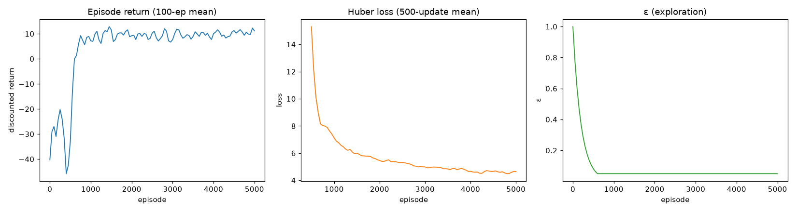

# Mask-Free Agent (Path 2)

> **Goal:** remove the playbook action mask entirely, offer every action in every
> state, and retrain so the agent has to **infer the hidden severity bucket from
> telemetry** — then read detection directly off its own actions. This makes the
> IDS claim non-circular: the agent detects because it perceives, not because the
> mask handed it the label.
>
> Artifacts: `src/rl_ids/train_maskfree.py`,
> `src/rl_ids/train_tabular_maskfree.py`, `src/rl_ids/maskfree_detect.py`,
> `tests/test_maskfree.py`,
> `data/processed/maskfree_dqn_report.md`, `maskfree_per_report.md`,
> `maskfree_tabular_report.md`, `maskfree_holdout_detection_report.md`,
> `models/double_dqn_maskfree.pt`, `models/double_dqn_per_maskfree.pt`.

---

## 1. What "remove the mask" actually means

The mask is not a filter bolted on top of a complete MDP — it is load-bearing.
`TRANSITIONS` and the reward's `_NET` table were **only defined for the playbook
actions**:

```
TRANSITIONS["Normal"]        = {Monitor: ...}                       # 1 action
TRANSITIONS["Suspicious"]    = {Monitor, DPI, Throttle, Honeypot}   # 4 actions
TRANSITIONS["Compromised"]   = {Monitor, Block, Isolate}            # 3 actions
```

Deleting the mask alone would crash on `TRANSITIONS["Normal"]["Block"]`. So
Path 2 is really **"build a total 3×6 MDP, then hide which actions are correct."**
The mask-free mode is gated by `IDSEnv2018(mask_actions=False)`; the masked MDP is
byte-identical to before, so every prior result still stands as the masked
baseline.

## 2. The new reward/transition design

Ten off-playbook `(state, action)` pairs were added. The design rule keeps the
**existing playbook entries untouched** and encodes three ideas:

- **inspection on benign traffic** is a wasted-cost no-op (not a claim);
- **mitigation on a benign state** is a false positive;
- **a soft action on a confirmed compromise** is a false negative.

| | Monitor | DPI | Throttle | Honeypot | Block | Isolate |
|---|---|---|---|---|---|---|
| **Normal** | NONE | NONE | NONE | FP | FP | FP |
| **Suspicious** | NONE | TN | TN | **TP** | FP | FP |
| **Compromised** | NONE | FN | FN | FN | **TP** | **TP** |

(Bold = playbook action.) Transitions: in a truly-`Normal` state the attack
dynamics are a property of the state, so all non-terminal actions share the
`Normal` kernel; `Suspicious`+`Block` resolves more often; `Compromised`+soft
actions resolve less often; `Isolate` is terminal from any state.

## 3. The design gate

The whole point is that the task is **unchanged** — only the mask is gone. This is
verified exactly, not assumed: the mask-free Bellman solution (value iteration
over all 18 pairs) has the **same optimal policy and the same optimal values** as
the masked one:

| Start state | Masked q* | Mask-free q* | Playbook argmax |
|---|---:|---:|---|
| Normal | 8.721 | 8.721 | Monitor |
| Suspicious | 23.163 | 23.163 | Honeypot |
| Compromised | 14.508 | 14.508 | Block |

Every other action is **strictly dominated** in every state (`tests/test_maskfree.py`
asserts this). So a mask-free agent that finds the playbook has genuinely
*perceived* the state rather than been told it.

## 4. Validation: tabular control (perfect perception)

Before any neural net, the mask-free tabular MC agent — which still sees the true
state — confirms the env/reward dynamics under the full action set:

```
data/processed/maskfree_tabular_report.md
```

First-visit GLIE MC control (40 000 episodes, α = 0.05) converges to
`Normal→Monitor, Suspicious→Honeypot, Compromised→Block`, with q* tracking the
mask-free Bellman solution (RMSE ≈ 2.0, all drift stopped). The mask-free MDP is
sound.

## 5. Retraining (both agents)

Same agent, environment, episodes (5 000), seed (7) and observation pipeline as the
masked phase — the **only** change is `mask_actions=False`. Both agents recover the
**full playbook policy** with no mask:

| Start state | Masked uniform | Mask-free uniform | Δ | Masked PER | Mask-free PER | Δ |
|---|---:|---:|---:|---:|---:|---:|
| Normal | 8.578 | 6.542 | −2.036 | 8.471 | 5.181 | −3.290 |
| Suspicious | 20.173 | 20.095 | −0.078 | 20.651 | 20.670 | +0.019 |
| Compromised | 14.387 | 12.996 | −1.391 | 14.298 | 12.776 | −1.522 |

The policy is identical in every bucket; only the returns drop, by the cost of
*perceiving* the bucket instead of being told it. `Normal` and `Compromised` pay
the most (occasional misreads cost a false positive or a false negative);
`Suspicious` is essentially free.



## 6. The payoff: detection from the agent's own actions

With no mask, the greedy action **is** the detection decision. The Q-argmax over
all six actions is a real classifier, so it can be scored directly on the
untouched holdouts — the non-circular version of the holdout evaluation (no probe
needed). The masked agents are included as the contrast: their mask-free Q-argmax
was never forced to encode the state, so it collapses.

**Corrupted observations, per model × holdout:**

| Model | Holdout | Accuracy | Macro F1 | Benign FPR |
|---|---|---:|---:|---:|
| mask-free uniform | 2018 Infiltration | 0.488 | 0.220 | 0.025 |
| mask-free uniform | 2017 PortScan+DDoS | 0.457 | 0.394 | 0.097 |
| mask-free PER | 2018 Infiltration | 0.451 | 0.214 | 0.099 |
| mask-free PER | 2017 PortScan+DDoS | 0.437 | 0.362 | 0.099 |
| masked uniform | any | ≈0.00 | ≈0.00 | **1.000** |
| masked PER | any | ≈0.00 | ≈0.00 | **1.000** |

The masked agents raise an alarm on **every** benign flow (FPR = 1.000) — they
collapse to the majority bucket, which is exactly the mask-leak in reverse. The
mask-free agents are the only ones that separate benign from attack.

Per attack label (mask-free uniform, corrupted):

| Holdout · label | Precision | Recall | F1 |
|---|---:|---:|---:|
| 2018 · Infilteration | 0.373 | 0.015 | 0.028 |
| 2017 · DDoS | 0.789 | 0.363 | 0.497 |
| 2017 · PortScan | 0.808 | 0.407 | 0.542 |

## 7. Reading the results

- **Benign FPR is the decisive column.** A degenerate "flag everything" detector
  can post non-zero macro F1 when attacks dominate a holdout — that is the masked
  agents (FPR = 1.000). Only the mask-free agents have an operating point worth
  anything.
- **2017 is the positive case.** The mask-free agent detects `DDoS` (recall 0.36)
  and `PortScan` (recall 0.41) at a ~0.10 benign false-alarm rate — a real,
  non-circular IDS result.
- **2018 `Infilteration` is the weak case.** The agent is conservative
  (FPR 0.025) but catches almost none of it (recall 0.015–0.081). The family has
  effectively no training counterpart (only 36 rows of the 2017-spelled
  `Infiltration`), so there is nothing to transfer. The 2018 macro F1 is dominated
  by the benign class and should be read with the recall column.
- **The mask did the detecting.** The same held-out flows that the masked agents
  cannot score (FPR 1.000) are the ones the mask *was* resolving. Removing it
  turns a circular result into a measurable — and honest — one.
- **Two views of the same limit.** The probe (`docs/holdout_evaluation.md`) and the
  policy detector agree: families with a training counterpart transfer, families
  without do not. The policy detector is stricter (lower benign FPR, lower recall)
  because it must commit to an action, but it needs no extra classifier on top of
  the agent.

## 8. Run it

```
PYTHONPATH=src python -m rl_ids.train_tabular_maskfree   # tabular gate (perfect perception)
PYTHONPATH=src python -m rl_ids.train_maskfree           # mask-free DQN + PER
PYTHONPATH=src python -m rl_ids.maskfree_detect          # policy-based holdout detection
```

## 9. Files

| File | Purpose |
|---|---|
| `src/rl_ids/train_tabular_maskfree.py` | mask-free tabular MC control (gate) |
| `src/rl_ids/train_maskfree.py` | mask-free Double DQN + PER training |
| `src/rl_ids/maskfree_detect.py` | policy-based holdout detection + figure |
| `src/rl_ids/config.py` | `ALL_ACTION_INDICES`, mask-free paths, full `TRANSITIONS` |
| `src/rl_ids/reward.py` | total `_NET` over 3×6 pairs; `enforce_legality` flag |
| `src/rl_ids/env.py` | `mask_actions` switch |
| `src/rl_ids/tabular.py` | `all_actions` Bellman / MC / greedy variants |
| `tests/test_maskfree.py` | env / reward / gate / helper tests |
| `docs/maskfree_agent.md` | this document |
